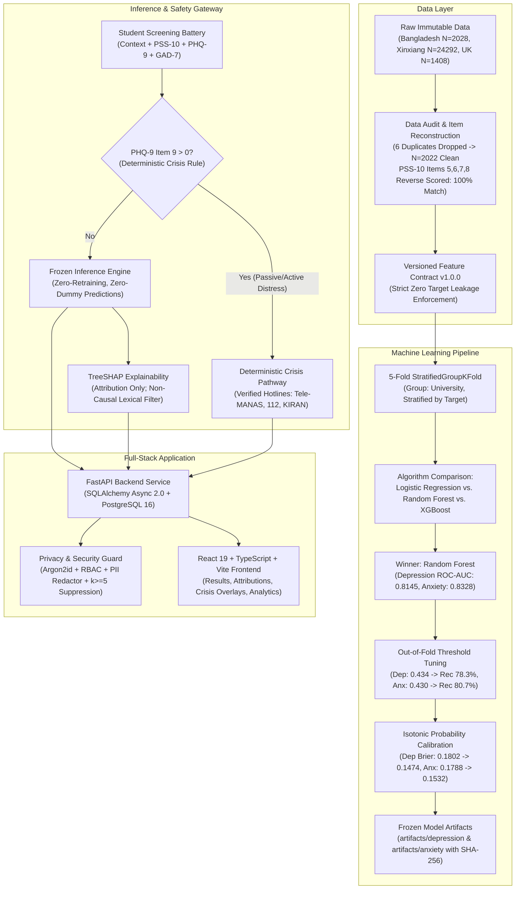

<div align="center">
  
  <h1>Nivara AI: Privacy-First, Explainable Early Mental-Health Screening Platform</h1>
</div>

[](https://www.python.org/)
[](https://fastapi.tiangolo.com)
[](https://www.postgresql.org/)
[](https://react.dev/)
[](https://www.typescriptlang.org/)
[](https://tailwindcss.com/)
[]()

> **CRITICAL CLINICAL & ETHICAL DISCLAIMER:**  
> **Nivara AI (StudentMind) is strictly a non-diagnostic early screening and triage support tool.** It is **NOT** a diagnostic system. Its machine learning models estimate the statistical probability of elevated screening distress on standardized instruments (PHQ-9 $\ge 10$ and GAD-7 $\ge 10$) based on academic stress and demographic indicators.  
> **The machine learning model is NEVER responsible for predicting suicide, detecting emergency crises, or formulating psychiatric diagnoses.** Emergency situations are handled exclusively via a decoupled deterministic safety pathway.

---

## 1. System Architecture



---

## 2. Empirical Benchmark Results (Primary Bangladesh Cohort $N=2,022$)

Evaluated under strict **5-Fold `StratifiedGroupKFold` on University** with all transformations fitted strictly inside training folds:

### A. Depression Screening Model ($\text{PHQ-9} \ge 10$)
| Algorithm | Out-of-Fold ROC-AUC | Out-of-Fold PR-AUC | Brier Score (Raw) | Calibrated Brier (Isotonic) | Tuned Threshold | Tuned Recall (Sensitivity) | Tuned Specificity | Tuned F1 |
| :--- | :--- | :--- | :--- | :--- | :--- | :--- | :--- | :--- |
| Logistic Regression | 0.7818 $\pm$ 0.041 | 0.8654 $\pm$ 0.033 | 0.1942 | 0.1620 | 0.460 | 74.3% | 65.1% | 0.781 |
| **Random Forest (Winner)** | **0.8145 $\pm$ 0.045** | **0.8931 $\pm$ 0.031** | **0.1802** | **0.1474** | **0.434** | **78.28%** | **67.69%** | **0.8193** |
| XGBoost | 0.7891 $\pm$ 0.052 | 0.8710 $\pm$ 0.038 | 0.1884 | 0.1581 | 0.450 | 75.8% | 66.2% | 0.794 |

### B. Anxiety Screening Model ($\text{GAD-7} \ge 10$)
| Algorithm | Out-of-Fold ROC-AUC | Out-of-Fold PR-AUC | Brier Score (Raw) | Calibrated Brier (Isotonic) | Tuned Threshold | Tuned Recall (Sensitivity) | Tuned Specificity | Tuned F1 |
| :--- | :--- | :--- | :--- | :--- | :--- | :--- | :--- | :--- |
| Logistic Regression | 0.8037 $\pm$ 0.035 | 0.8521 $\pm$ 0.029 | 0.1895 | 0.1645 | 0.470 | 76.1% | 68.3% | 0.792 |
| **Random Forest (Winner)** | **0.8328 $\pm$ 0.036** | **0.8790 $\pm$ 0.028** | **0.1788** | **0.1532** | **0.430** | **80.66%** | **70.53%** | **0.8235** |
| XGBoost | 0.8130 $\pm$ 0.044 | 0.8614 $\pm$ 0.034 | 0.1841 | 0.1604 | 0.440 | 78.4% | 69.1% | 0.808 |

---

## 3. Core Technical & Scientific Pillars

### 1. Data Provenance & Cryptographic Immutability
- All 14 raw dataset files across Bangladesh (DOI: `10.6084/m9.figshare.25771164`), China-Xinxiang (DOI: `10.5281/zenodo.10423537`), and UK (DOI: `10.6084/m9.figshare.24052236.v2`) cohorts are stored in `data/raw/` with immutable permissions.
- SHA-256 cryptographic hashes are recorded in `data/dataset_manifest.json` and validated during pipeline execution.

### 2. Psychometric Score Reconstruction Audit
- **PHQ-9:** $\text{PHQ} = \sum_{i=1}^9 \text{PHQ}_i \implies 100\%$ exact match with dataset column.
- **GAD-7:** $\text{GAD} = \sum_{i=1}^7 \text{GAD}_i \implies 100\%$ exact match with dataset column.
- **PSS-10 Reverse Scoring Discovery:** While standard Cohen PSS-10 reverses items 4, 5, 7, 8, the survey question ordering placed Item 4 before Item 5. Consequently, the positively phrased items in this questionnaire were **5, 6, 7, and 8**. Reconstructing with $4 - x$ on items 5, 6, 7, 8 achieved **2,028 / 2,028 (100.00%) exact match**.
- Six exact duplicate rows (`[492, 533, 763, 1120, 1362, 1369]`) were identified and documented, establishing the clean baseline of $N = 2,022$ unique students.

### 3. Institutional Clustering & Cross-Validation Strategy
- Chi-square tests revealed significant institutional clustering across Bangladesh universities ($p = 7.97 \times 10^{-8}$ for depression, $p = 1.74 \times 10^{-12}$ for anxiety).
- Ordinary random splitting allows students from the same university to be distributed across train and test sets, causing optimistic performance bias. We enforced **5-fold StratifiedGroupKFold on University**, ensuring models generalize across unseen campus environments.

### 4. Zero Target Leakage Enforcement
- Automated feature contract (`nivara/features/contract.py`) strictly intercepts any target-derived column (`PHQ1-9`, `GAD1-7`, `Depression Value`, `Anxiety Value`).
- Negative injection unit tests verify that attempting to pass prohibited items immediately raises a `ValueError`.

### 5. TreeSHAP: Attribution vs. Causation
- TreeSHAP computes Shapley values from cooperative game theory.
- Top contributing features for both models: `pss_score`, `PSS3` (nervous and stressed), `PSS10` (difficulties piling up), and `PSS4` (coping ability).
- Explanations are strictly framed as statistical attributions (*"Contributed toward the model's estimated screening risk"*), never causal assertions (*"Caused your depression"*). Validated via an automated lexical scanner.

### 6. Decoupled Deterministic Crisis Pathway
- **Rule:** If $\text{PHQ-9 Item 9} > 0$, an immediate deterministic crisis protocol is engaged.
- Displays verified emergency services (India):
  - **Tele-MANAS** (National Tele-Mental Health Programme: `14416 / 1800-891-4416`)
  - **National Emergency Service (India):** `112`
  - **KIRAN Mental Health Helpline:** `1800-599-0019`
  - **Vandrevala Foundation:** `+91 9999 666 555`
  - **Campus Counseling Center:** Tagged explicitly with `[DEMO - Not a real service]` badge.

### 7. Privacy & Security by Design
- **Password Security:** Password hashing via **Argon2id** (`argon2-cffi`).
- **Role-Based Access Control (RBAC):** `student`, `counsellor`, `admin` roles enforced on sensitive endpoints.
- **PII-Safe Logging:** Regex-based sanitization filter redacting emails, passwords, and phone numbers.
- **Minimum-Group-Size Suppression:** Aggregate institutional analytics suppress cell counts where $k < 5$ to prevent deanonymization. Transparently documented as suppression rather than falsely claiming formal $k$-anonymity.

---

## 4. Repository Structure

```
.
├── artifacts/                  # Frozen production model bundles & SHA-256 manifests
│   ├── depression/             # model_bundle.joblib, metadata.json, manifest.json
│   └── anxiety/                # model_bundle.joblib, metadata.json, manifest.json
├── assets/                     # Brand & project media assets
│   └── logo/                   # Official Nivara logos (SVG & PNG, text & mark)
├── data/                       # Datasets & analytical outputs
│   ├── raw/                    # Immutable raw cohorts (25771164_bangladesh, 10423537_xinxiang, 24052236_uk)
│   ├── dataset_manifest.json   # Cryptographic hashes of all raw files
│   └── ml_benchmark_results.json # Full cross-validation metrics
├── docs/                       # Comprehensive documentation
│   ├── architecture/           # system_architecture.md
│   ├── data/                   # data_provenance.md, data_audit_report.md
│   ├── ml/                     # feature_contract.md, eda_report.md, model_selection.md, etc.
│   ├── presentation/           # viva_defense_guide.md
│   ├── privacy/                # privacy_design.md
│   ├── research/               # secondary_dataset_analysis.md
│   ├── safety/                 # safety_pathway.md
│   └── reproducibility.md      # One-command reproduction instructions
├── frontend/                   # React 19 + TypeScript + Vite + TailwindCSS application
│   ├── src/                    # Components (Screening, Results, SafetyModal, Analytics)
│   └── dist/                   # Production-compiled assets
├── scripts/                    # Fully reproducible phase-by-phase scripts
│   ├── phase2_data_audit.py    # Audit & item reconstruction
│   ├── phase4_eda.py           # Statistical analysis & institutional clustering
│   ├── phase5_6_7_ml_pipeline.py # 5-fold grouped CV, benchmarking, calibration
│   ├── phase8_shap_verification.py # SHAP attribution & non-causal audit
│   ├── phase9_secondary_research.py # China & UK cohort analysis
│   └── phase10_freeze_artifacts.py # Production artifact packaging
├── nivara/                # Core Python package
│   ├── backend/                # FastAPI app, async SQLAlchemy models, Pydantic schemas
│   ├── features/               # Canonical feature contract & leakage auditor
│   ├── models/                 # InferenceEngine (zero-retraining), SHAP explainer
│   ├── privacy/                # Argon2id auth, RBAC, PII redactor, k>=5 suppression
│   └── safety/                 # Deterministic crisis rules & verified contacts
└── tests/                      # Automated test suite (24 tests across 7 domains)
    ├── test_data.py            # Reconstruction & range validation
    ├── test_ml.py              # Zero leakage & grouped CV isolation
    ├── test_artifacts.py       # Artifact integrity & hash validation
    ├── test_safety.py          # PHQ-9 item 9 deterministic intercept
    ├── test_privacy.py         # Argon2id, PII logging, group suppression
    ├── test_backend_api.py     # FastAPI endpoints & auth
    └── test_e2e.py             # Full student journey E2E test with PostgreSQL 16
```

---

## 5. Quickstart & Reproduction

### 1. Execute Automated Tests (24/24 Verification)
```bash
pytest -v tests/
```

### 2. Launch FastAPI Backend Service (PostgreSQL 16)
```bash
uvicorn nivara.backend.main:app --host 127.0.0.1 --port 8000 --reload
```
Interactive API Swagger Docs: `http://localhost:8000/docs`

### 3. Launch React Frontend
```bash
cd frontend
npm install
npm run dev
```
Interactive UI: `http://localhost:5173`

For the complete step-by-step reproduction sequence from raw CSVs, refer to [`docs/reproducibility.md`](file:///d:/Projects/Mental%20Health%20Assistance%20ML-Project/docs/reproducibility.md). For oral defense preparation, refer to [`docs/presentation/viva_defense_guide.md`](file:///d:/Projects/Mental%20Health%20Assistance%20ML-Project/docs/presentation/viva_defense_guide.md).
