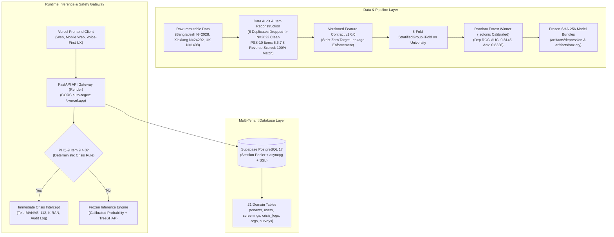

<div align="center">
  
  <h1>Nivara AI: Privacy-First, Explainable Early Mental-Health Screening Platform</h1>
</div>

[](https://www.python.org/)
[](https://fastapi.tiangolo.com)
[](https://supabase.com/)
[-61DAFB.svg)](https://vercel.com/)
[](https://render.com/)
[](https://www.typescriptlang.org/)
[](https://tailwindcss.com/)
[](https://alembic.sqlalchemy.org/)

> **CRITICAL CLINICAL & ETHICAL DISCLAIMER:**  
> **Nivara AI (StudentMind) is strictly a non-diagnostic early screening and triage support tool.** It is **NOT** a diagnostic system. Its machine learning models estimate the statistical probability of elevated screening distress on standardized instruments (PHQ-9 $\ge 10$ and GAD-7 $\ge 10$) based on academic stress and demographic indicators.  
> **The machine learning model is NEVER responsible for predicting suicide, detecting emergency crises, or formulating psychiatric diagnoses.** Emergency situations are handled exclusively via a decoupled deterministic safety pathway.

---

## 1. System Architecture & Production Deployment

Nivara is built as a cloud-native, decoupled micro-architecture:

- **Frontend:** React 19 + TypeScript + Vite hosted on **Vercel** (`https://nivara-wheat.vercel.app`) with SPA rewrites.
- **Backend:** FastAPI + Uvicorn + SQLAlchemy 2.0 Async running on **Render** (Python 3.11.9 runtime).
- **Database:** **Supabase PostgreSQL 17** accessed via the Session Pooler (`aws-0-ap-northeast-1.pooler.supabase.com:5432`) using `asyncpg` with SSL and statement caching disabled (`statement_cache_size=0`).
- **Schema Migrations:** Authoritatively managed via **Alembic** (Baseline revision: `20261102_0001`).



---

## 2. Empirical Benchmark Results (Primary Bangladesh Cohort $N=2,022$)

Evaluated under strict **5-Fold `StratifiedGroupKFold` on University** with all transformations fitted strictly inside training folds:

### A. Depression Screening Model ($\text{PHQ-9} \ge 10$)
| Algorithm | Out-of-Fold ROC-AUC | Out-of-Fold PR-AUC | Brier Score (Raw) | Calibrated Brier (Isotonic) | Tuned Threshold | Tuned Recall (Sensitivity) | Tuned Specificity | Tuned F1 |
| :--- | :--- | :--- | :--- | :--- | :--- | :--- | :--- | :--- |
| Logistic Regression | 0.7818 $\pm$ 0.041 | 0.8654 $\pm$ 0.033 | 0.1942 | 0.1620 | 0.460 | 74.3% | 65.1% | 0.781 |
| **Random Forest (Winner)** | **0.8145 $\pm$ 0.045** | **0.8931 $\pm$ 0.031** | **0.1802** | **0.1474** | **0.434** | **78.28%** | **67.69%** | **0.8193** |
| XGBoost | 0.7891 $\pm$ 0.052 | 0.8710 $\pm$ 0.038 | 0.1884 | 0.1581 | 0.450 | 75.8% | 66.2% | 0.794 |

### B. Anxiety Screening Model ($\text{GAD-7} \ge 10$)
| Algorithm | Out-of-Fold ROC-AUC | Out-of-Fold PR-AUC | Brier Score (Raw) | Calibrated Brier (Isotonic) | Tuned Threshold | Tuned Recall (Sensitivity) | Tuned Specificity | Tuned F1 |
| :--- | :--- | :--- | :--- | :--- | :--- | :--- | :--- | :--- |
| Logistic Regression | 0.8037 $\pm$ 0.035 | 0.8521 $\pm$ 0.029 | 0.1895 | 0.1645 | 0.470 | 76.1% | 68.3% | 0.792 |
| **Random Forest (Winner)** | **0.8328 $\pm$ 0.036** | **0.8790 $\pm$ 0.028** | **0.1788** | **0.1532** | **0.430** | **80.66%** | **70.53%** | **0.8235** |
| XGBoost | 0.8130 $\pm$ 0.044 | 0.8614 $\pm$ 0.034 | 0.1841 | 0.1604 | 0.440 | 78.4% | 69.1% | 0.808 |

---

## 3. Core Technical & Clinical Pillars

### 1. Data Provenance & Cryptographic Immutability
- Raw cohorts across Bangladesh (DOI: `10.6084/m9.figshare.25771164`), China-Xinxiang (DOI: `10.5281/zenodo.10423537`), and UK (DOI: `10.6084/m9.figshare.24052236.v2`) cohorts are preserved in `data/raw/`.
- SHA-256 cryptographic hashes are recorded in `data/dataset_manifest.json` and validated during execution.

### 2. Psychometric Score Reconstruction Audit
- **PHQ-9:** $\text{PHQ} = \sum_{i=1}^9 \text{PHQ}_i \implies 100\%$ exact match.
- **GAD-7:** $\text{GAD} = \sum_{i=1}^7 \text{GAD}_i \implies 100\%$ exact match.
- **PSS-10 Reverse Scoring:** Positively phrased items were identified as **5, 6, 7, and 8** due to questionnaire arrangement. Reconstructing with $4 - x$ achieved **2,028 / 2,028 (100.00%) exact match**.
- Six exact duplicate rows (`[492, 533, 763, 1120, 1362, 1369]`) dropped, establishing clean baseline of $N = 2,022$ students.

### 3. TreeSHAP Attribution (Non-Causal Explanation)
- Top contributing features: `pss_score`, `PSS3` (nervous and stressed), `PSS10` (difficulties piling up), `PSS4` (coping ability).
- Explanations are strictly framed as statistical attributions (*"Contributed toward estimated screening probability"*), never causal claims (*"Caused your distress"*), enforced by automated lexical scanning.

### 4. Decoupled Deterministic Safety Pathway
- If $\text{PHQ-9 Item 9} > 0$, an immediate deterministic crisis protocol is engaged.
- Verified national emergency helplines:
  - **Tele-MANAS** (`14416 / 1800-891-4416`)
  - **National Emergency Service (India):** `112`
  - **KIRAN Mental Health Helpline:** `1800-599-0019`
  - **Vandrevala Foundation:** `+91 9999 666 555`

### 5. Multi-Tenant Architecture & Institutional Governance
- Supports self-contained campus tenants with custom branding, crisis contacts, and student cohorts.
- Institutional registration and template provisioning workflows (`/org/register`, `/org/login`, `/org/dashboard`).
- Minimum-group-size suppression ($k \ge 5$) on aggregate institutional analytics.

---

## 4. Default Demo & Administrative Accounts

To seed these accounts into your database, execute:
```bash
python scripts/seed_demo_accounts.py
```

| Role | Email | Password | Scope | Default Login Page |
| :--- | :--- | :--- | :--- | :--- |
| **Platform Super Admin** | `admin@test.com` | `DemoAdmin2026!` | Global Platform Governance | `/login` $\to$ `/admin` |
| **Institution Admin** | `admin@demo-univ.ac.in` | `DemoAdmin2026!` | Campus Workspace Management | `/login` $\to$ `/admin` |
| **Clinic Counsellor** | `counsellor@demo-univ.ac.in` | `DemoCounsellor2026!` | Clinical Case Queue & Triage | `/login` $\to$ `/counsellor` |
| **Organization Partner** | *(Self-registered)* | *(Set at registration)* | Institutional Partner Portal | `/org/login` $\to$ `/org/dashboard` |

---

## 5. Environment Configuration

### Backend `.env` Configuration (Render / Local)
```ini
PROJECT_NAME="Nivara AI"
VERSION="1.1.0"
SECRET_KEY="your-secure-jwt-secret-key"
ACCESS_TOKEN_EXPIRE_MINUTES=120

# Supabase PostgreSQL Session Pooler URL (URL-encoded password)
DATABASE_URL=postgresql+asyncpg://postgres.<project_ref>:<url_encoded_password>@aws-0-ap-northeast-1.pooler.supabase.com:5432/postgres

# Connection Pool & SSL Settings
DB_SSL_REQUIRED=true
DB_POOL_SIZE=5
DB_MAX_OVERFLOW=5
DB_POOL_RECYCLE=300
DB_CONNECT_TIMEOUT=10

# CORS Allowed Origins
ALLOWED_ORIGINS="http://localhost:5173,http://localhost:3000,http://localhost:8000,https://nivara-wheat.vercel.app"
```

### Frontend Environment Variables (Vercel)
In Vercel **Project Settings $\to$ Environment Variables**:
* `VITE_API_URL` (or `VITE_API_BASE_URL`): `https://<your-render-backend-url>/api`

---

## 6. Local Quickstart & Development

### 1. Run Automated Test Suite
```bash
pytest -v tests/
```

### 2. Run Database Migrations
```bash
alembic upgrade head
```

### 3. Launch Backend Service
```bash
python -m uvicorn nivara.backend.main:app --host 127.0.0.1 --port 8000 --reload
```
Swagger UI: `http://localhost:8000/docs`

### 4. Launch Frontend
```bash
cd frontend
npm install
npm run dev
```
Local Application: `http://localhost:5173`

---

## 7. Repository Structure

```
.
├── .python-version             # Python version pin (3.11.9) for Render
├── runtime.txt                 # Buildpack runtime pin (python-3.11.9)
├── vercel.json                 # Vercel SPA routing rewrites configuration
├── pyproject.toml              # Authoritative PEP 517/621 project dependencies
├── alembic/                    # Database migration chain
│   └── versions/               # Baseline schema revision (20261102_0001)
├── artifacts/                  # Frozen production model bundles & SHA-256 manifests
│   ├── depression/             # model_bundle.joblib, metadata.json, manifest.json
│   └── anxiety/                # model_bundle.joblib, metadata.json, manifest.json
├── data/                       # Datasets & benchmark manifests
│   └── raw/                    # Immutable cohorts (Bangladesh, Xinxiang, UK)
├── docs/                       # Architecture, ML, Privacy, and Safety specifications
├── frontend/                   # React 19 + TypeScript + Vite application
│   ├── vercel.json             # Frontend SPA rewrite rules
│   └── src/                    # Pages, components, api client, and auth
├── nivara/                     # Core Python package
│   ├── backend/                # FastAPI app, API routers, database engine, models, schemas
│   ├── features/               # Feature contracts & leakage auditor
│   ├── models/                 # InferenceEngine, TreeSHAP explainer
│   ├── privacy/                # Argon2id auth, RBAC, PII redaction, k>=5 suppression
│   └── safety/                 # Deterministic crisis rules & verified contacts
├── scripts/                    # Seeding, audit, and verification utilities
│   ├── seed_demo_accounts.py   # Populates demo accounts in PostgreSQL
│   └── test_supabase_live_integration.py # Live Supabase end-to-end integration tests
└── tests/                      # Automated unit, regression, and safety tests
```

---

## 8. License & Acknowledgments
Nivara AI is released for research and student wellbeing screening evaluation. Standardized clinical assessment scales (PHQ-9, GAD-7, PSS-10) are public domain instruments utilized under standard academic and clinical screening guidelines.
