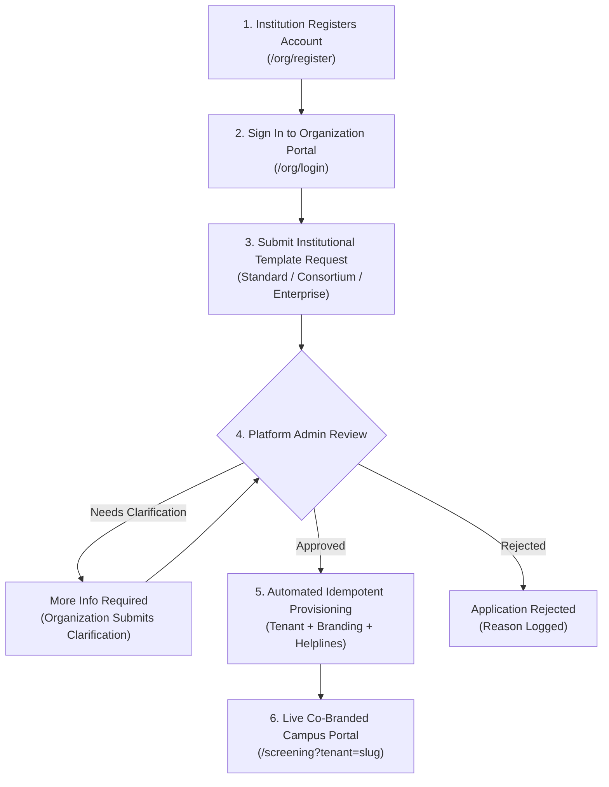

# Nivara AI — Institutional Workflow & Request Lifecycle

## 1. Overview & End-to-End Journey

Nivara provides educational institutions, colleges, and student organizations with dedicated, co-branded, privacy-compliant mental health screening workspaces.

The institutional onboarding and template request workflow follows a 6-stage lifecycle:

---

## 2. Step-by-Step Lifecycle Specification

### Step 1: Registration (`/org/register`)
- The institutional representative registers with official email, university details, and authorized representative credentials.
- Automatic apex-domain derivation (e.g. `nitt.edu`) establishes institutional provenance.
- Default account status: `pending_verification`.

### Step 2: Authentication & Organization Dashboard (`/org/dashboard`)
- The authorized representative signs in at `/org/login`.
- The dashboard displays real-time account status, profile management, active template applications, and onboarding guides.

### Step 3: Template Request Submission
- Organization navigates to **Template & Workspace Requests** tab.
- Submits requirements:
  - **Intended Use**: Operational scope (e.g., annual campus screening for 4,000 freshmen, mid-term stress check).
  - **Requested Plan**:
    - `standard_institution`: Dedicated campus portal with standardized PHQ-9, GAD-7, PSS-10 screening and counsellor triage.
    - `consortium`: Cross-campus federated research data contribution with differential privacy guarantees.
    - `enterprise_custom`: Custom SSO, on-premise hotline routing, and department cohort analytics.
  - **Estimated Users**: Cohort size.
  - **Custom Subdomain**: Preferred tenant slug (e.g., `nitk-wellness`, `iitb-care`).
  - **Technical Notes**: Specific helpline routing, language requirements, or campus resources.

> [!IMPORTANT]
> **Active Duplicate Prevention**: The system enforces that an organization can have only **one** active template request (`draft`, `submitted`, `under_review`, `more_info_required`, or `approved`) at a time. New submissions while an active request exists are blocked with `HTTP 400 Bad Request`.

### Step 4: Platform Administrator Review (`/admin`)
- Platform administrators review applications under the **Template Requests & Orgs** tab.
- Status transition matrix:
  - `submitted` $\rightarrow$ `under_review`
  - `under_review` $\rightarrow$ `more_info_required` (with admin notes explaining questions)
  - `under_review` $\rightarrow$ `approved` (ready for provisioning)
  - `under_review` $\rightarrow$ `rejected` (with formal rationale)

### Step 5: Clarification & Resubmission Loop
- When an application status is set to `more_info_required`, the organization dashboard immediately highlights an **"ACTION REQUIRED"** badge.
- The organization enters clarification notes (e.g., verified crisis helpline numbers or academic calendar dates) and submits.
- The request transitions back to `submitted` and notifies platform reviewers.

### Step 6: Workspace Provisioning & Handover
- Once approved, the platform administrator clicks **"Provision Institutional Workspace"**.
- The automated engine provisions the tenant, creates branding entries, assigns permissions, and returns the workspace URL.
- The organization dashboard updates to display the live tenant slug, direct student screening link (`/screening?tenant=<slug>`), and counsellor triage access (`/counsellor`).

