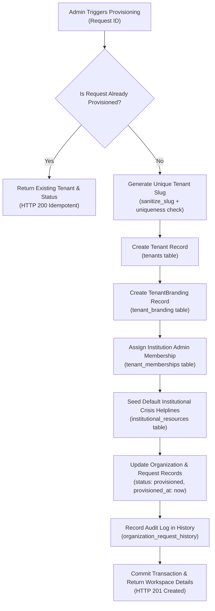

# Nivara AI — Institutional Template Provisioning Specification

## 1. Purpose

This document outlines the architecture, database schema modifications, provisioning engine, and idempotency guarantees for instantiating dedicated institutional workspaces from approved template requests.

---

## 2. Provisioning Architecture

When an administrator triggers provisioning on an `approved` template request via `POST /api/organizations/admin/template-requests/{id}/provision`, the provisioning engine executes a single atomic transaction:



---

## 3. Database Objects Created During Provisioning

### 1. `Tenant` (`tenants` table)
- `id`: Cryptographic UUID (v4)
- `name`: Organization / Institution Name
- `slug`: Lowercase alphanumeric sanitized slug (e.g. `apex-institute`, `nitk-wellness`)
- `domain`: Official institutional domain (e.g. `apex.edu.in`)
- `institution_type`: Extracted from request plan / organization type
- `contact_email`: Official institutional email
- `is_active`: `True`

### 2. `TenantBranding` (`tenant_branding` table)
- `tenant_id`: Foreign key to `tenants.id`
- `primary_color`: Configured brand primary (default: `#1C3A13` Forest Green)
- `accent_color`: Configured brand secondary (default: `#D3FA99` Lime Accent)
- `portal_title`: `"[Institution Name] Student Wellbeing Sanctuary"`
- `support_email`: Official institutional contact email
- `support_phone`: Authorized contact phone number
- `custom_welcome_text`: Institutional guidance note

### 3. `TenantMembership` (`tenant_memberships` table)
- `tenant_id`: Foreign key to `tenants.id`
- `user_id`: Organization admin `User` record UUID
- `role`: `"institution_admin"`

### 4. `InstitutionalResource` (`institutional_resources` table)
- National Crisis Tele-MANAS (24/7 Helpline: `14416`)
- Campus Health & Counselling Emergency contact
- Dedicated emergency triage instructions

---

## 4. Idempotency Guarantees

In distributed cloud environments or intermittent network conditions, provisioning calls may be retried:

1. **Pre-condition Check**:
   If the template request status is already `provisioned`, or if `provisioned_tenant_id` is already populated, the engine bypasses creation and immediately returns:
   ```json
   {
     "status": "already_provisioned",
     "tenant_id": "...",
     "tenant_slug": "...",
     "message": "Tenant workspace was already provisioned for this request."
   }
   ```
2. **Slug Collision Defense**:
   If a requested subdomain slug conflicts with an existing tenant, the sanitizer automatically appends a pseudorandom cryptographic hexadecimal suffix (e.g. `nitt-9b3f`) ensuring unique index constraints are never violated.
3. **Atomic Unit of Work**:
   All operations run inside an SQLAlchemy `async with session.begin()` block. Any transient failure rolls back all records, leaving no orphaned tenants or half-configured branding rows.

